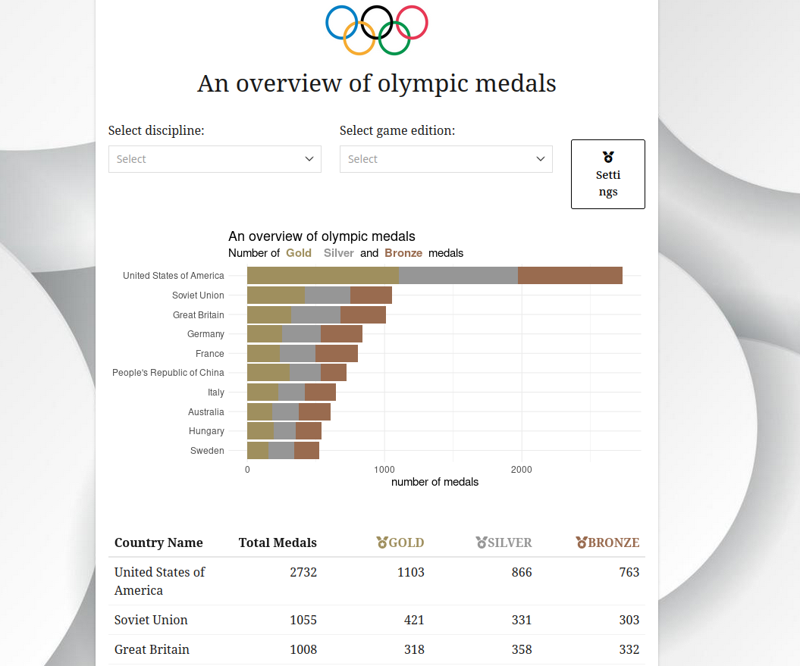
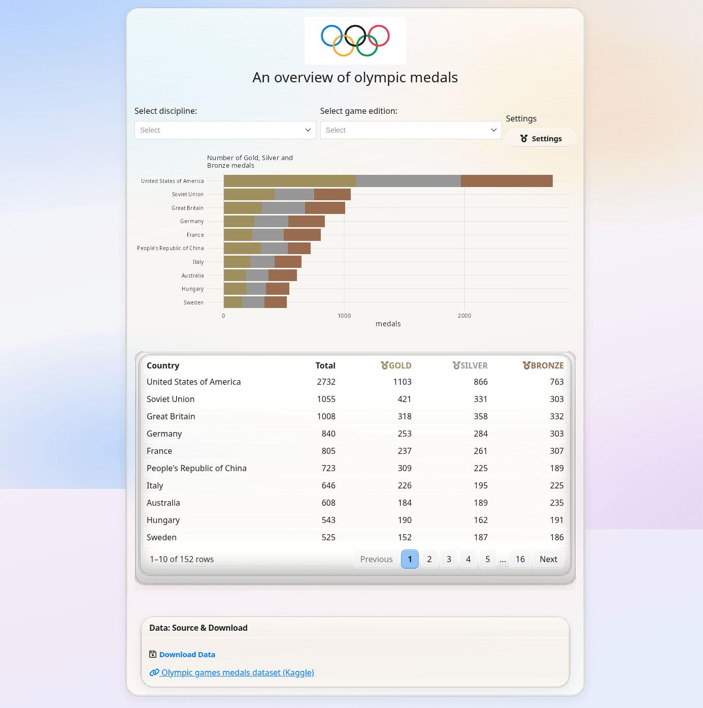
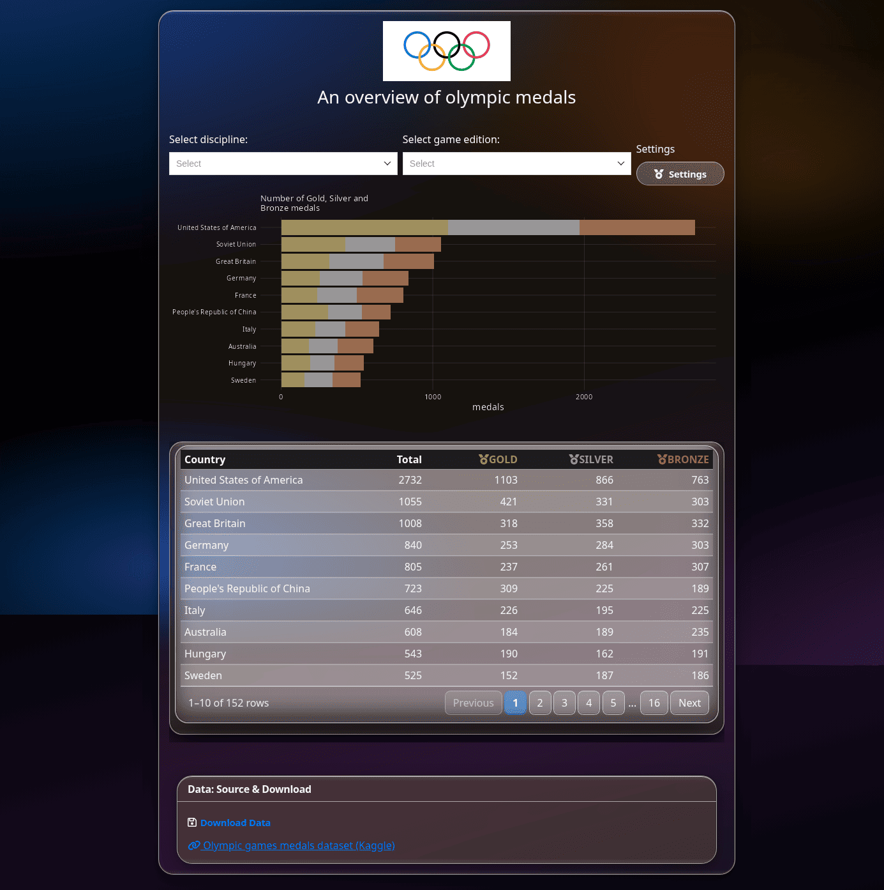

Theme packages usually get shown on apps built to show them off. I wanted to see how shinyglass did on an app someone else wrote, so one of its hosted demos is the [Olympic medals app](https://github.com/dreamRs/shinyapps/tree/main/olympic-medals) from [dreamRs](https://www.dreamrs.fr/). dreamRs publishes a set of example Shiny apps under GPL-3, and this one is small and well put together: two filters, a settings menu, a ggplot bar chart, a reactable table and a download link, all inside one bslib card.

This post goes through what changed between their version and the [live shinyglass version](https://ericrayanderson.shinyapps.io/glass-olympics/). The changes split into the one line that switches the theme and a list of smaller edits that came after it.

## Before

{fig-alt="The original dreamRs Olympic medals app: a white card over a grey background photo, Olympic rings, two dropdowns, a Settings button, a stacked bar chart of medals by country and a table"}

This is the screenshot from the dreamRs repository. The original theme is a plain `bs_theme()`:

```r
ui <- fluidPage(
  title = "R-Olympics",
  theme = bs_theme(
    version = 5,
    preset = "bootstrap",
    bg = "#FFFFFF",
    fg = "#000000",
    primary = "#E3E3E3",
    secondary = "#000000",
    base_font = "Maven Pro"
  ),
  setBackgroundImage(src = "pic2.jpg"),
  ...
)
```

A small thing you can see in the screenshot: `base_font = "Maven Pro"` names the font but doesn't load it, so on a machine without Maven Pro installed the browser falls back to its default serif. That's why the title and table are in a serif face. `bslib::font_google("Maven Pro")` would fetch it.

## The one line

The theme change itself is one line. `glass_theme()` returns a `bs_theme()`, so it goes in the same slot:

```r
ui <- fluidPage(
  title = "R-Olympics",
  theme = glass_theme(preset = "auto"),
  ...
)
```

`preset = "auto"` follows the visitor's light or dark setting. The card, the buttons and the inputs pick up the glass surfaces from this alone, because they are standard Bootstrap and bslib components. shinyglass also has rules for reactable tables and Virtual Select menus, since both show up in a lot of Shiny apps. The demo gets the preset from an environment variable so the screenshot script can force light or dark, but that's the only difference.

## After

{fig-alt="The same app with shinyglass in light mode: a translucent glass card over a soft pastel background, a lighter settings button, a smaller chart and a glass table with pagination"}

{fig-alt="The same app with shinyglass in dark mode: a dark glass card over a dark blue and purple background"}

## What else changed

I diffed dreamRs' `app.R` and `R/visualisation.R` against the shinyglass copy (`inst/shinyapps/olympic-medals/app-glass.R` in the shinyglass repo). Apart from the theme line, most of the edits fall into a few groups.

### Hard-coded colors came out

The original Settings button had `style = "color: black; background-color: white; border-color: black"`, the icons had `color: black`, and the links had `color: blue`. Those are fine on a white page and wrong in dark mode, where you end up with a black icon on a dark card. The glass version deletes those inline styles and lets the theme color them. The medal colors (gold `#9F8F5E`, silver `#969696`, bronze `#996B4F`) stayed, because they mean something and read fine on both backgrounds.

### The background photo went away

`setBackgroundImage("pic2.jpg")` puts a grey photo behind the page. shinyglass draws its own page background so the glass has something soft to blur, so the call was removed. You can keep a photo if you want one. `glass_theme(wallpaper = ...)` takes an image and puts it behind a blur and a light wash so text still has enough contrast.

### The plot needed to be told about the theme

A ggplot rendered by `renderPlot()` is a PNG with a white background, which looks like a sheet of paper stuck on the glass. The glass version passes `bg = "transparent"` to `renderPlot()` and adds `shinyglass::theme_glass(input = input)` to the plot so the axis text and grid lines match the current light or dark preset:

```r
output$graph <- renderPlot(
  {
    visualisation_medal(x = data_in(), input = input)
  },
  height = hght,
  res = 96,
  bg = "transparent"
)
```

Inside `visualisation_medal()`, the plot starts from `theme_minimal(base_size = 11)`, then `theme_glass()` goes on top. The original also had a colored markdown subtitle through `ggtext::element_markdown()`. The glass version uses a plain subtitle wrapped at 32 characters, which also drops the ggtext dependency, and it drops the plot title because the page already has the same heading above it.

### Dropdowns had to escape the card

Glass cards clip their contents (`overflow: hidden`) so the rounded corners and blur stay clean. That also clips any dropdown that opens inside the card. The demo tells `shinyWidgets::virtualSelectInput()` to render its menu on `<body>` instead:

```r
virtualSelectInput(
  inputId = "discipline",
  label = "Select discipline:",
  choices = unique(medals_summer$discipline_title),
  multiple = TRUE,
  width = "100%",
  position = "bottom",
  dropboxWrapper = "body",
  zIndex = 1080
)
```

shinyglass's JavaScript now sets `dropboxWrapper = "body"` on virtual selects by default, so in a current app you only need this if you want to be explicit.

### Layout for narrow screens

The original used `column(width = 8, offset = 2)` for the whole card, which leaves wide side margins on a laptop. The glass version uses a full-width container capped at 960px, gives the filter columns `width = 12` with `col-md-5` so they stack on small screens, wraps the reactable in a horizontally scrolling `div`, and caps the plot height at 900px. The table also got `compact = TRUE`, a sticky country column and shorter headers ("Country" and "Total"). A short block of CSS in `tags$head()` handles the rest, mostly keeping the plot image and table inside the card.

### Two leftovers from the original

The favicon pointed at `rings.png`, but the file in `www/` is `rings.jpg`, so both shinyglass copies of the app point at `rings.jpg`. `library("shinydashboard")` was loaded but not used, and it's gone from the glass version.

## What I haven't fixed

Look at the dark screenshot and you'll see the Olympic rings sitting in a white box. The logo is a JPEG with a white background, and no theme can make that transparent. A PNG with transparency would fix it. The two dropdown fields are also still white in that dark screenshot. The Virtual Select library draws them, not Bootstrap, so they need their own CSS rules for dark mode.

## Checking your own app

If you try `glass_theme()` on an app you already have, these are the things this one ran into:

- Search for `style =` and inline colors. Anything that sets black, white or a hex color directly will be wrong in one of the two modes. Let the theme handle it or use Bootstrap classes.
- Add `bg = "transparent"` to `renderPlot()` and put `theme_glass(input = input)` on ggplots. For base graphics, `glass_plot_colors(input = input)` gives you the ink and fill colors.
- Open every dropdown, popover and date picker inside a card. If one gets cut off at the card edge, it needs to render on `<body>`.
- Look at logos and images in dark mode. White JPEG backgrounds show up straight away.
- Check that the fonts you name are actually loaded. shinyglass sets its own font stack, so a `base_font` from your old theme no longer applies.
- Try it at phone width. shinyglass handles the touch sizes and keeps pages from scrolling sideways, but your own column widths still decide whether filters stack or squeeze.
- Turn on reduced motion and reduced transparency in your OS settings and look again. The app should still be readable with solid fills and no animation.

The live demo is at <https://ericrayanderson.shinyapps.io/glass-olympics/>. It can take a few seconds to wake up. On a desktop, the Phone view button shows it in a phone-sized frame. The full source is in the [shinyglass repository](https://github.com/ericrayanderson/shinyglass/tree/main/inst/shinyapps/olympic-medals), next to the original dreamRs files, and the package docs are at <https://ericrayanderson.github.io/shinyglass/>. Thanks to dreamRs for publishing these apps under an open license. It made this kind of comparison easy to do.
