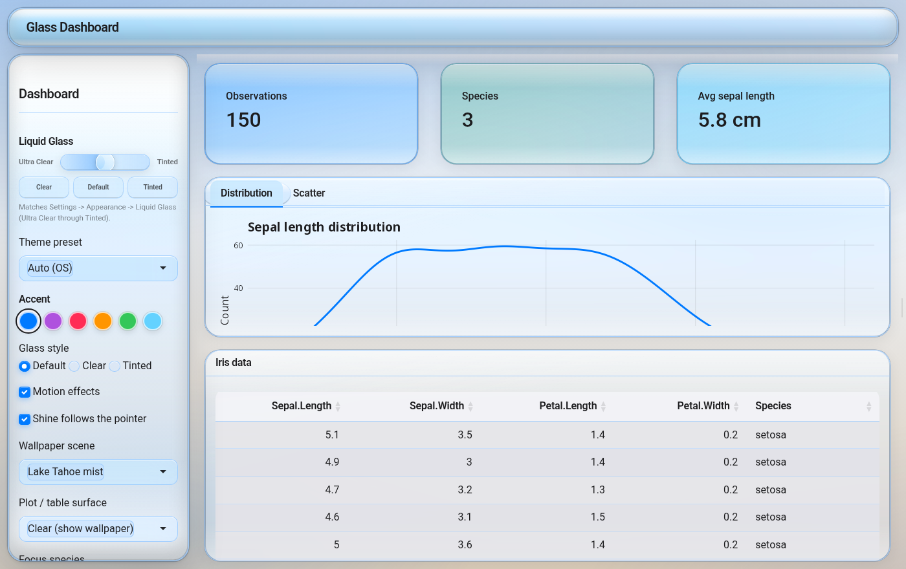
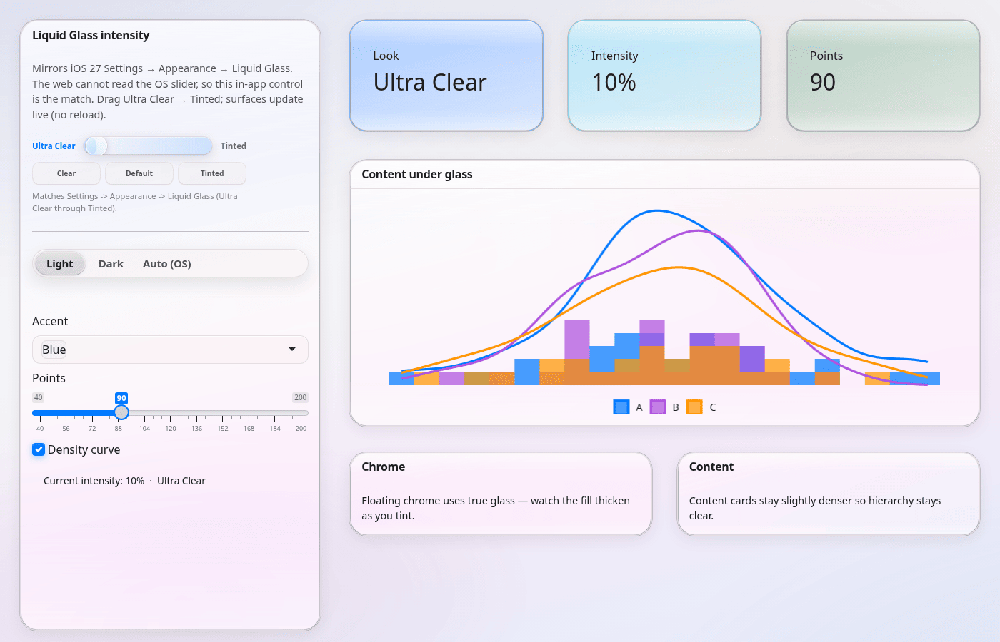
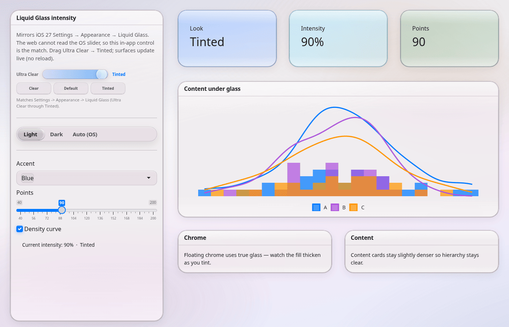

shinyglass is an R package that gives Shiny apps a look close to Apple's Liquid Glass design. Version 0.6.0 went to CRAN this month. A few people have asked how it works, so this post walks through the parts that make it look like glass and what they cost in the browser.

{fig-alt="A bslib dashboard with the shinyglass theme in light mode: glass sidebar, value boxes, a plot card, and a data table"}

## Using it

Install it from CRAN:

```r
install.packages("shinyglass")
```

On a bslib page, pass `glass_theme()` as `theme` and call `observe_glass()` in the server:

```r
library(shiny)
library(bslib)
library(shinyglass)

ui <- page_sidebar(
  title = "Existing app",
  theme = glass_theme(preset = "auto", intensity = 0.5),
  sidebar = sidebar(
    glass_theme_toggle(),
    glass_intensity_slider()
  ),
  "Main column"
)

server <- function(input, output, session) {
  observe_glass(input, session)
}

shinyApp(ui, server)
```

`preset = "auto"` follows the operating system's light or dark setting. The toggle switches between Light, Dark and Auto, and the slider runs from Ultra Clear (`0`) to Tinted (`1`). `observe_glass()` is the server side of those two controls.

## It's a bslib theme

`glass_theme()` returns a normal `bslib::bs_theme()`, so it works anywhere `theme =` works: `page_sidebar()`, `page_navbar()`, `fluidPage()` or `navbarPage()`. It builds the theme in three steps.

First it calls `bs_theme(version = 5, ...)` with Bootstrap variables for rounder corners, button padding and font weight. One of those is `"min-contrast-ratio" = 3`. Bootstrap's default contrast check wants 4.5:1, and white text on Apple's system blue (`#007AFF`) comes out around 4.02:1, so Bootstrap picks black text for primary buttons. Dropping the ratio to 3, the WCAG minimum for UI components, lets white text win on blues and purples while pale colors still get dark text.

Next, `bs_add_variables()` adds the `$glass-*` Sass variables, and `bs_add_rules()` adds the package's SCSS file. That file is over 7,000 lines now. Most of it is not glass at all. It's per-component fixes, because every Bootstrap component has its own idea of what its background should be.

Last, `bs_bundle()` attaches the JavaScript as `htmltools::htmlDependency()` objects through `sass::sass_layer(html = ...)`. The scripts travel with the theme, so there's nothing extra to put in the UI. One of those dependencies is a small script in the page head that sets `data-glass-preset` on `<html>` before the first paint, which keeps dark mode from flashing white on load.

## The blur

The base of every glass surface is CSS `backdrop-filter`:

```css
backdrop-filter:
  blur(calc(var(--glass-blur) * var(--glass-diffusion, 1.06)))
  saturate(var(--glass-saturate))
  brightness(var(--glass-refract-brightness, 1.04))
  contrast(var(--glass-refract-contrast, 1.04));
```

The defaults are a 36px blur and 200% saturation. Blur on its own looks like frosted plastic, though. Most of what makes a card read as glass is the edge: a stack of inset `box-shadow` lines that are light on the top and bottom and a little darker on the sides, plus a soft glow just inside the top edge. A `::before` layer on top adds gradient sheens at the top and bottom.

Every one of those values is a CSS custom property. The intensity slider interpolates between two sets of values, one for Ultra Clear and one for Tinted, and writes the result on `:root`. If you want to change one directly, `glass_css_tokens()` lists them and `glass_theme(tokens = list(blur = "28px"))` overrides them without touching the SCSS.

::: {layout-ncol=2}
{fig-alt="The intensity demo at the Ultra Clear end of the slider"}

{fig-alt="The intensity demo at the Tinted end of the slider"}
:::

## Bending the background

Chromium goes one step further. Its `backdrop-filter` accepts `url()` pointing at an SVG filter, so shinyglass builds a displacement map for each glass surface, shaped to that element's border radius, and runs the backdrop through `feDisplacementMap`. That is what bends the background near the edges like a lens. With dispersion on, it runs three displacement passes at slightly different strengths, keeps one color channel from each, and adds them back together, which gives a faint color fringe at the rim.

This is the expensive part, so it's limited. Only the 8 highest-ranked surfaces on screen get the lens, and they have to be at least 72 by 32 pixels. Dispersion is skipped on devices that report 4 or fewer CPU cores, 4 GB of memory or less, or Save-Data mode. Safari and Firefox don't accept `url()` there, so they get blur and tint without the lens. Honestly, the plain version still looks good, and it's what Safari and Firefox users see.

## The highlight that follows the mouse

On desktop, a soft shine follows the pointer across cards, value boxes, the navbar, menus and buttons. The JavaScript listens for `pointermove`, finds the nearest glass surface, and writes the pointer position on it as two percentages. CSS draws the shine:

```css
.glass-pointer-lit {
  --glass-pointer-sheen: radial-gradient(
    circle at var(--glass-specular-x, 50%) var(--glass-specular-y, 0%),
    color-mix(in srgb, var(--glass-specular-top, #fff) calc(var(--glass-pointer-strength, 0.32) * 100%), transparent) 0%,
    transparent 58%
  );
}
```

Updates go through `requestAnimationFrame` and are capped at about 30 a second. Touch input is ignored, and it stops while the tab is hidden. `glass_theme(pointer_specular = FALSE)` turns it off, and a `data-glass-no-pointer-specular` attribute turns it off for one element.

## Tabs that slide

Bootstrap tabs and pills just move an `.active` class from one item to the next. For the sliding pill, shinyglass adds one `<span class="glass-morph-indicator">` to each nav group, measures the active item with `getBoundingClientRect()`, and moves the span there with a CSS transform. A CSS transition does the sliding. On top of that, a short Web Animations call scales the pill to `1.14 0.92` partway through the move and back to `1 1`, so it stretches in the direction it travels and settles. The first placement on page load skips the transition, otherwise the pill would fly in from the corner.

## Tint from the content

Real glass picks up color from what's behind it. shinyglass fakes this with the app's plots. When Shiny sends a new value to a plot output, or a plot image finishes loading, it waits 400 ms, then draws each plot image and canvas into a 72 by 72 canvas and reads the pixels back. Near-white pixels are skipped so a white plot background doesn't wash everything out, and more saturated pixels count for more. The average color becomes the tint for the glass fills, and the intensity slider still decides how strong it is.

A small gotcha if you try this yourself: drawing an image from another origin into a canvas and reading it back throws a security error. The sampler catches that and skips the image, so a plot served from somewhere else just doesn't add to the tint.

## Reduced motion and other system settings

Every moving part checks `prefers-reduced-motion`. When it's on, the pointer shine is off, the tab pill jumps instead of sliding, button press springs and the ambient sheen stop, and tint sampling doesn't run. `glass_theme(motion = FALSE)` does the same thing for every visitor. The system setting takes priority over theme options, so a visitor with reduced motion on never gets the animations even if the app asks for them.

Reduced transparency in the OS gets solid fills with no backdrop blur. Increased contrast and forced colors also turn off the lens and override the glass colors.

## Phones

The same app works on a phone with no extra code. Controls are sized for touch (the slider thumb gets bigger on coarse pointers), sidebars and popovers open and close the way you'd expect, and pages don't scroll sideways. The mouse highlight is desktop only, since there's no pointer to follow. Each live demo has a Phone view button that shows the app in a phone-sized frame.

## Try it

Two of the hosted demos:

- [Olympic medals](https://ericrayanderson.shinyapps.io/glass-olympics/), dreamRs' [olympic-medals](https://github.com/dreamRs/shinyapps/tree/main/olympic-medals) app with the shinyglass theme
- [Dashboard](https://ericrayanderson.shinyapps.io/glass-dashboard/), cards, plots and tables on bslib

They may take a few seconds to wake up. The [documentation](https://ericrayanderson.github.io/shinyglass/) has the [theming guide](https://ericrayanderson.github.io/shinyglass/articles/theming.html) and a list of supported widgets, and the source is on [GitHub](https://github.com/ericrayanderson/shinyglass). If something looks off in your app, an issue with a screenshot helps a lot. Bootstrap components I haven't tried yet are the most likely place for it to break.
